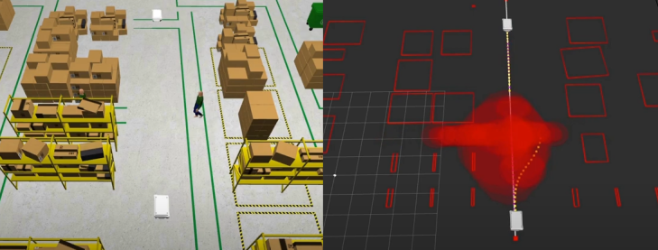

# Dynamic Obstacle Avoidance with EBM and MPC

Warehouse and hospital navigation with EBM prediction and MPC. [RA-L paper](https://ieeexplore.ieee.org/document/11021381).



<details>
<summary>Citation</summary>

```bibtex
@ARTICLE{ze_2025_ebmmpc,
  author={Zhang, Ze and Hess, Georg and Hu, Junjie and Dean, Emmanuel and Svensson, Lennart and Åkesson, Knut},
  journal={IEEE Robotics and Automation Letters},
  title={Future-Oriented Navigation: Dynamic Obstacle Avoidance With One-Shot Energy-Based Multimodal Motion Prediction},
  year={2025}, volume={10}, number={8}, pages={8043-8050}, doi={10.1109/LRA.2025.3575969}
}
```

</details>

## Setup

Requires Python 3.11 and the [OpEn/PANOC prerequisites](https://alphaville.github.io/optimization-engine/docs/installation). Install [uv](https://docs.astral.sh/uv/), then run from the repository root:

```bash
uv sync --locked
uv run --locked python scripts/build_solver.py
```

<details>
<summary>Conda alternative (not verified)</summary>

```bash
conda env create -f environment.yml
conda activate dyobav
python -m pip install -r requirements-conda.txt
python -m pip install --no-deps -e .
python scripts/build_solver.py
```

</details>

## Run

After building the solver, launch either scene:

```bash
uv run --locked python scripts/run_simulation.py --scene warehouse
uv run --locked python scripts/run_simulation.py --scene hospital
```

Device: `--device auto|cpu|cuda`. View: `--view full|map`. All options:

```bash
uv run --locked python scripts/run_simulation.py --help
```

Examples:

```bash
# CPU, headless, short run
uv run --locked python scripts/run_simulation.py --scene hospital --device cpu --duration 10 --visualization off

# Evaluated run saved to a new output directory
uv run --locked python scripts/run_simulation.py --scene warehouse --evaluation --seed 0 --output-dir runs/eval-001

# Record MP4 video (create its parent directory first)
mkdir -p runs
uv run --locked python scripts/run_simulation.py --scene warehouse --save-video runs/warehouse.mp4
```

Use a new output directory or video filename. Video requires visualization, one repetition, and an existing parent folder. EBM supports CPU/CUDA; SGAN requires CUDA.

## Checks and extras

```bash
PYTHONPATH=src uv run --locked python -m unittest discover -s tests -v
PYTHONPATH=src uv run --locked python scripts/smoke.py
```

Utilities: `scripts/build_map.py`, `scripts/plot_successrate.py`, and `scripts/view_graph.py` (add `--background` to show node coordinates over the source image). Interactive demos are in `tests/demos/`, for example `uv run --locked python tests/demos/demo_agents.py` (requires a graphical session).

ROS 2/Gazebo is maintained on the [ROS 2 branch](https://github.com/Woodenonez/DyObAv-MPCnEBM-Warehouse/tree/ros2-version) and in the [ROS 2 repository](https://github.com/Woodenonez/DyObAv-MPCnEBM-Warehouse-ROS2). Videos: [ROS 2/Gazebo](https://youtu.be/j4n2mt0KdMY) · [Python simulation](https://youtu.be/nNLAS4Hfgtk).


